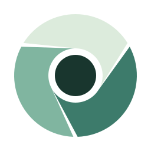
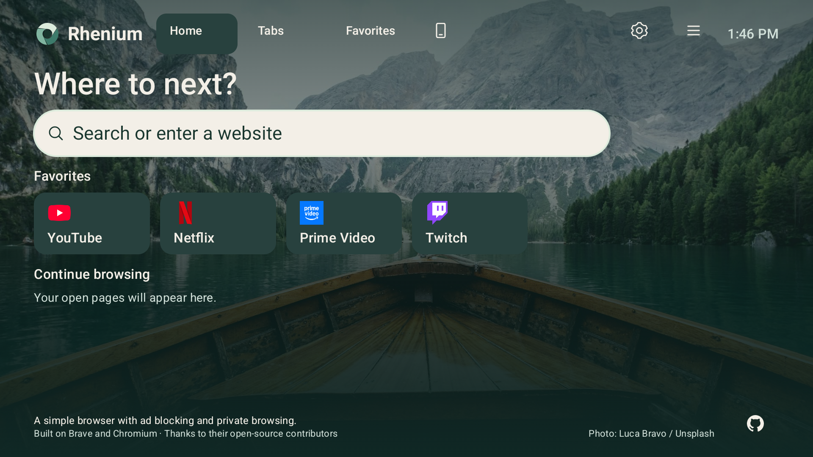

<div align="center">
  
  <h1>Rhenium</h1>
  <p><strong>A simple browser with ad blocking and private browsing.</strong></p>
  <p>Built for Android TV and Google TV. Powered by Brave and Chromium.</p>
  <p>
    <a href="#features">Features</a> ·
    <a href="#remote-controls">Remote controls</a> ·
    <a href="#get-started">Get started</a> ·
    <a href="#development">Development</a> ·
    <a href="#license-and-credits">License</a>
  </p>
</div>



Rhenium brings everyday web browsing to the television, with a native interface
designed for a remote and a screen across the room. Search, open your favorite
sites, switch tabs and browse pages using the D-pad. A pointer is a long press away.

## Features

- **A home for your TV.** A scenic background, prominent search bar, favorites,
  open-page shortcuts and clear focus states that follow system text scaling.
- **Browse with the remote.** Jump between links, buttons and fields. Keep moving
  at the visible edge to scroll; hold OK to switch to a pointer when needed.
- **Ad and tracker blocking.** Brave Shields, packaged filter rules and verified,
  signed filter-data updates. See [how filter updates work](docs/filter-updates.md).
- **Private browsing.** Native private tabs, with normal saved and recent pages
  excluded from private Home.
- **Your browser essentials.** Tabs, favorites, history, downloads, page controls,
  Shields and settings in a menu built for TV navigation.
- **A phone remote.** Pair through the Phone icon on Home to enter text and
  control browsing from your phone's browser, with approval on the TV.
- **A few familiar starting points.** YouTube, Netflix, Prime Video and Twitch
  are editable starter favorites with their official logos.

## Remote controls

On a webpage, element navigation is the default:

| Remote input | Action |
| --- | --- |
| D-pad arrows | Move between selectable elements; scroll at the visible edge |
| OK | Activate the selected link or button; open the keyboard for a selected text field |
| Hold OK for about 0.65 seconds | Switch between element navigation and pointer mode, without activating the selection |
| Back | Open browser controls |

Moving onto a text field keeps the keyboard closed until you press OK. Native
keyboards, dialogs and fullscreen players handle their own input and Back first.
The menu also exposes **Jump between elements** and **Browse page**.

## Get started

Rhenium is in active development. Current builds have been exercised on a
Google Chromecast with Google TV running Android 14 (32-bit ARM) and an
Android TV emulator running Android 16 (x86-64). Broader device coverage,
streaming playback, DRM compatibility and release packaging are still being tested.

**There is no public browser APK release yet.** The assets currently on the
[Releases page](https://github.com/smolcars/rhenium/releases) are signed filter
snapshots. To try the browser now, build a matching APK using the instructions below.

For a TV already paired with ADB, replace `DEVICE_SERIAL` and the APK path:

```sh
adb -s DEVICE_SERIAL install -r /path/to/BraveMonoarm.apk
```

Open **Rhenium** from your TV's app list. Build outputs and the development
package ID (`com.brave.browser_default`) retain their existing internal names.

### Connect your phone

1. Put your phone and TV on the same local network.
2. Open the **Phone** icon on Home and scan the QR code or use the manual pairing option.
3. Approve the connection on the TV. Use **Disconnect** in Phone when finished.

The phone connection currently uses **unencrypted local HTTP**. Use a trusted
network and avoid sending passwords or sensitive text through it. Private
browsing does not make your activity anonymous to websites or your network provider.

## Development

Use **x86-64 Linux** and **Nix with flakes enabled**. The Nix shell provides host
tools; Brave and Chromium fetch their pinned browser dependencies separately.
Allow substantial disk space and memory for the Chromium build; follow the
[build guide](docs/build.md) for initialization and resource limits.

```sh
git clone --recurse-submodules https://github.com/smolcars/rhenium.git
cd rhenium
nix develop
python3 tools/checkout.py "$HOME/.cache/brave-tv/workspace"
cd "$HOME/.cache/brave-tv/workspace/src/brave"
```

On a **new build workspace**, initialize dependencies once:

```sh
pnpm run init --target_os=android --target_arch=x64 --no-history
```

Build for an x86-64 Android TV emulator:

```sh
SISO_LIMITS=local=4 pnpm run build Debug \
  --target_os=android --target_arch=x64 --target_android_output_format=apk \
  --gn=android_static_analysis:on
```

For the tested 32-bit ARM Chromecast, use the optimized, non-debuggable configuration:

```sh
SISO_LIMITS=local=4 pnpm run build Static \
  --target_os=android --target_arch=arm --target_android_output_format=apk \
  --gn=android_static_analysis:on --gn=symbol_level:0 --gn=debuggable_apks:false
```

Choose the target for your device's ABI. These commands produce
`src/out/android_Debug/apks/BraveMonox64.apk` and
`src/out/android_Static_arm/apks/BraveMonoarm.apk`, relative to the external workspace.
Keep existing dependencies and build outputs when rebuilding.

### Source and checks

This repository contains the development environment, tooling, artwork and docs.
The browser source is the [`brave/` submodule](https://github.com/smolcars/brave-tv-core).
Edit it directly, commit and push its source changes, then commit the updated
submodule reference here. The [source workflow](docs/source-workflow.md) explains
how to synchronize the external builder safely.

Run project checks from the project root inside `nix develop`:

```sh
python3 -m unittest discover -s tests -v
mypy --strict tools tests
nix flake check "git+file://$PWD?submodules=1"
```

These checks cover project tooling and input policy. Android builds and native
device tests verify the actual browser.

## Contributing

[Report a bug or suggest a feature](https://github.com/smolcars/rhenium/issues).
For bugs, include the TV model, Android version, browser source/build revision,
website and steps to reproduce. Screenshots or a short recording help with
remote-navigation issues; remove personal information before sharing them.

For source changes, follow the [engineering plan](docs/engineering-plan.md) and
[native checklist](docs/tv-native-checklist.md). Include focused checks and native
screenshots for UI changes, including enlarged system text. Original contributions
use MPL 2.0; preserve existing license headers and third-party notices.

Useful references: [build guide](docs/build.md) · [emulator setup](docs/emulator.md) ·
[device testing](docs/device-tests.md) · [design system](DESIGN.md) ·
[current branding and hardware evidence](docs/rhenium-branding-evidence.md).

## License and credits

Unless otherwise noted, Rhenium's original code, documentation and artwork are
licensed under the **[Mozilla Public License 2.0](LICENSE)**, matching Brave Core.
Existing upstream and third-party materials retain their own licenses and notices;
see [NOTICE.md](NOTICE.md) for scope and attribution.

Rhenium is an independent project built on [Brave](https://github.com/brave/brave-core)
and [Chromium](https://www.chromium.org/). Thanks to their open-source contributors.
Home photography is by [Luca Bravo / Unsplash](https://unsplash.com/photos/brown-wooden-boat-moving-towards-the-mountain-O453M2Liufs).
The Mint Orbit logo and editable artwork are in [`assets/`](assets/rhenium-artwork.md).
